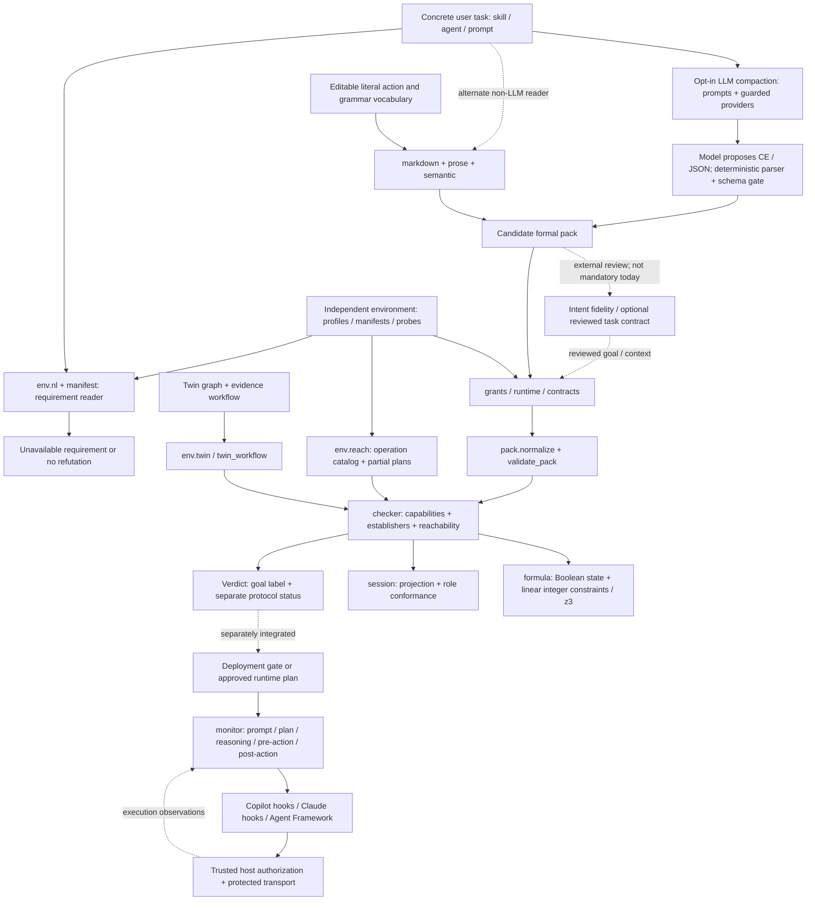

# SkillC knowledge graph: from words to guarded actions

Source baseline: `dd157dbd`, synchronized with the local prompt refactor on 28 October 2026.
Open [the interactive HTML guide](KNOWLEDGE_GRAPH.html) for a directed graph
with clickable, line-numbered Python source panels, concrete user intents,
LLM CE/JSON compaction and the searchable module directory. It works offline
without installing anything. The embedded source excerpts are exact for this
snapshot; the illustrative model reply is stubbed, not a live-model recording.

## 1. User intents: what the person actually asks

These are verbatim task descriptions from standalone skill documents in this
repository, not comparison fixtures, environment inventories or result traces.
They are authored skill examples, not recorded conversations with real users.

| Use case | User-facing intent, verbatim | Standalone skill source |
|---|---|---|
| Release notes | "Summarise the merged pull requests and post the release note to the team Slack channel." | [`post-release-note.md`](../demo/skillc-here/skills/post-release-note.md) |
| Coding | "Find the failing test in this repository, fix the code and confirm the suite passes." | [`fix-failing-test.md`](../demo/skillc-here/skills/fix-failing-test.md) |
| Interactive learning | "Quiz the learner on today's topic with an interactive card." | [`quiz-widget/SKILL.md`](../examples/runtime-skills/quiz-widget/SKILL.md) |
| Restaurant search | "Ask which evening suits the user, then look up restaurants open that evening." | [`pick-an-evening/SKILL.md`](../examples/runtime-skills/pick-an-evening/SKILL.md) |

Each source link opens the actual skill document; the table quotes only its
task description. Environment grants and observed outcomes are separate inputs.
An intent can also be an agent instruction or a plain prompt. The report task
below illustrates those formats; it is not a recorded user conversation:

```text
SKILL.md body:
Draft a report, obtain approval, then send the approved report to the finance team.
Do not send an unapproved draft.

Agent instruction:
You prepare reports for the finance team. Obtain approval before sending a draft.

Prompt:
Draft a report, obtain approval, then send the approved report to the finance team.
Do not send an unapproved draft.
```

### What SkillC decides about those requests

SkillC asks **whether a declared goal has a possible route through declared tools,
permissions, preconditions and effects**. Its core is a small compiler and a
symbolic reachability procedure, not a model that judges another model's answer.

Three different things must not be confused:

1. **Intent:** what the person wants. Reading it can be heuristic or model-assisted.
2. **Declaration:** a formal pack describing a world and a protocol. The checker
   decides this object, not the original person's full meaning.
3. **Execution:** what tools actually do. Runtime verification and trusted
   authorization must connect the declaration to the concrete action.

`IMPOSSIBLE` is a refutation relative to the declaration and its abstraction
assumptions. `ACHIEVABLE` is structural admissibility, not guaranteed execution,
intent fidelity, authorization or security. `UNKNOWN` is an abstention.
The [domain vocabulary](../CONTEXT.md) and [verdict coverage](VERDICT_COVERAGE.md)
define the exact boundary.

## 2. Knowledge graph

The arrows below describe **artifact flow**, not an exhaustive Python call graph.
The module directory in section 7 provides the code-level navigation.



### The important edges

| Relationship | Meaning | Source |
|---|---|---|
| Markdown reader **produces** a candidate pack | Extracts source declarations, invocations and, when supported, task semantics | [`compile_markdown`](../src/skillc/frontend/markdown.py), [`semantic.build`](../src/skillc/frontend/semantic.py) |
| Prose reader **names** logical conditions | Completion clauses become predicates and numeric comparisons | [`parse_goal`, `condition_predicate`](../src/skillc/frontend/prose.py) |
| Vocabulary **configures** the no-model reading | JSON extends literal action phrases, invocation verbs, completion phrases and workflow headings | [`vocabulary`](../src/skillc/frontend/vocabulary.py) |
| Environment **grants**, intent **requires** | A tool mentioned in a document is not automatically authorized in a target environment | [`bind_grants`](../src/skillc/frontend/grants.py) |
| Contracts **replace** assumed behavior | Aligned environment effects/guards replace intent assumptions; incompatible vocabularies are reported | [`bind_environment`, `apply_contracts`](../src/skillc/frontend/contracts.py) |
| Runtime binding **maps** abstract tools | CE `via` maps to a runtime tool; `needs` adds resource guards | [`bind_runtime`](../src/skillc/frontend/runtime.py) |
| Pack **constrains** the checker | Schema validation rejects malformed syntax, not misunderstood intent | [`normalize`, `validate_pack`](../src/skillc/pack.py) |
| Checker **uses** formulas and sessions | z3 handles constraints; projection and conformance check role coordination | [`check`](../src/skillc/checker.py), [`formula`](../src/skillc/formula.py), [`session`](../src/skillc/session.py) |
| Verdict **does not equal** authorization | Admission also needs acceptable protocol status; protected actions need a trusted runtime boundary | [`Verdict.admissible`](../src/skillc/checker.py), [`ApprovalGate`](../src/skillc/security.py) |
| Tool observations **revise** runtime state | Missing programs, credentials or network can revoke an approved plan | [`Monitor.post_action`](../src/skillc/monitor.py) |

These are alternate entry paths. For example, plain `compile_markdown` does not
automatically probe a tenant or invoke `bind_environment`; the caller selects and
performs the appropriate binding. Runtime manifests, tool profiles and
`skillc.env/1` graphs are related representations, **not interchangeable schemas**.

## 3. How natural language becomes logic blocks

### Worked case: user intent to logic blocks

**Plain input:** "Draft a report, obtain approval, then send the approved report
to the finance team. Do not send an unapproved draft."

Here is the proposed translation of that request, phrase by phrase:

| Words in the request | Proposed logic block | Meaning |
|---|---|---|
| "Draft a report" | `draft_report: pre = true; add = {drafted}` | An action establishes the Boolean fact `drafted` |
| "obtain approval" | `approve_report: pre = drafted; add = {approved}` | A separate action follows drafting; approval authenticity is not established here |
| "then send the approved report" | `send_report: pre = approved; add = {sent}` | Sending requires approval and establishes the modeled outcome `sent` |
| "Do not send an unapproved draft" | `send_report.pre = approved` | A false approval fact blocks this declared action |
| "Draft ..., obtain ..., then send ..." | `protocol = [draft_report, approve_report, send_report]` | Ordered protocol steps |
| "send the approved report" | `goal = sent` | Abstract completion condition; initially no workflow facts hold: `init_true = []` |
| "to the finance team" | **Not represented in this minimal pack** | Recipient, report content/version and approval identity still need reviewed contracts and host authorization |

These are annotations of the proposed output, not a keyword lookup or a record
of internal model reasoning. Names such as `drafted` are chosen for the formal
representation. The CE below expresses these blocks; the HTML also shows the
equivalent core JSON.

The LLM proposes the report workflow's goal, operations, preconditions and
effects from this request. That proposal still needs intent-fidelity review and
deterministic static validation. The model receives the task plus schema/grammar
instructions and, for runtime-bound CE, an independent runtime manifest.

**The runtime manifest is not LLM output.** In this walkthrough it is a
hand-authored example; in use, the host supplies it independently.
`tools` lists runtime tools and `grants` lists available resources. The model
may reference those names, but its output is not evidence that they exist.
It corresponds to **Environment context** in the HTML graph, feeding
**Build model prompt** and later **Independent grants**.

| Compaction-section item | Corresponding graph box |
|---|---|
| Plain-language request | [User task text](KNOWLEDGE_GRAPH.html#node-intents) |
| Host-supplied runtime manifest | [Environment context](KNOWLEDGE_GRAPH.html#node-environment) |
| Task + CE grammar + runtime vocabulary | [Build model prompt](KNOWLEDGE_GRAPH.html#node-prompts) |
| Provider invocation | [Guarded model call](KNOWLEDGE_GRAPH.html#node-provider) |
| Model's proposed CE/JSON | [LLM compaction](KNOWLEDGE_GRAPH.html#node-llm) |
| Parse and schema validation | [Parse + schema gate](KNOWLEDGE_GRAPH.html#node-parse) |
| Check `via` and `needs` against the manifest | [Independent grants](KNOWLEDGE_GRAPH.html#node-binding) |
| Explicit reviewed-contract substitution | [Reviewed tool contracts](KNOWLEDGE_GRAPH.html#node-contracts) |
| Symbolic decision over the bound declaration | [Deterministic checker](KNOWLEDGE_GRAPH.html#node-checker) |

A representative model proposal is:

```ce
Skill `reviewed-report`.
Roles: `agent`.
Tool `draft_report` (owner `agent`): via `write`; adds `drafted`.
Tool `approve_report` (owner `agent`): via `ask_user`; requires `drafted`; adds `approved`.
Tool `send_report` (owner `agent`): via `mail_send`; needs `mail_account`; requires `approved`; adds `sent`.
Goal: `sent`.
Protocol:
  - `agent` uses `draft_report`.
  - `agent` uses `approve_report`.
  - `agent` uses `send_report`.
```

This is **illustrative model output**, tested by injecting a stubbed provider
reply into the real compaction functions. It is not evidence that a live model
produced the right interpretation. The illustrative runtime independently grants
`write`, `ask_user`, `mail_send` and resource `mail_account`. The candidate's
generic approval effect is not itself authenticated human approval.

After parsing the CE, runtime binding adds `needs:mail_account` to the initial
facts and the send guard. Under the illustrative host's grants, the real checker
accepts this witness. Showing only workflow facts:

```text
{}
  -- draft_report --> {drafted}
  -- approve_report --> {drafted, approved}
  -- send_report --> {drafted, approved, sent}
```

The fixture produces `ACHIEVABLE`, `admissible = true`, with witness
`[draft_report, approve_report, send_report]`. Skip approval and sending is
blocked; withdraw `mail_send` and a capability is missing; remove `mail_account`
and its resource guard fails. Tests exercise those exact cases through the real
compaction, binder and checker, with only the model reply stubbed.

**This is not a fully faithful end-to-end translation of the original request.**
The minimal pack does not represent the finance-team recipient, bind approval
to the same report version or authenticate the approver. Its `approved` and
`sent` facts describe assumed action effects, not observed approval or delivery.
Intent review, reviewed tool contracts and host authorization must address those
gaps before protected execution.

The HTML lets you switch between this CE proposal and its core JSON pack.
It also embeds the real implementations:
[model call and compaction](KNOWLEDGE_GRAPH.html#code-llm),
[prompt construction](KNOWLEDGE_GRAPH.html#code-prompts),
[provider boundary](KNOWLEDGE_GRAPH.html#code-provider),
[runtime binding](KNOWLEDGE_GRAPH.html#code-binding) and
[explicit contract substitution](KNOWLEDGE_GRAPH.html#code-contracts).

### Inside Build model prompt: SYSTEM, USER and source pieces

`ce_runtime_messages` builds instructions for the LLM; it does not itself
translate the request into logic. The reusable template is programmer-written;
the task-specific CE is proposed by the model afterward.
`_ce_runtime_sections` organizes the content into output instructions, extraction,
runtime bindings, reply policy, goal scope, syntax and runtime context. Builders
join named sections instead of splitting or patching prompt sentences.

```text
SYSTEM: How to translate, what CE syntax to use, and what the runtime provides.
USER:   The actual natural-language task, followed by "CE document:"
```

| Piece | Purpose | Corresponding code in the HTML inspector |
|---|---|---|
| `CE_OUTPUT_INSTRUCTIONS` + `CE_EXTRACTION_RULES` | Output format and translation instructions: goals, actions, guards, effects, roles and protocol steps | [Output and extraction blocks](KNOWLEDGE_GRAPH.html#code-prompt-head) |
| `CE_RUNTIME_BINDING_RULE` | Map operations to runtime tools using `via`; declare required accounts/resources using `needs` | [Runtime mapping rule](KNOWLEDGE_GRAPH.html#code-prompt-runtime-rule) |
| `CE_REPLY_RULES_BY_VERSION` | Select a complete named policy for internal work, inline deliverables or final-deliverable-only replies | [Reply policies + version map](KNOWLEDGE_GRAPH.html#code-prompt-rule9) |
| `CE_BRANCH_AND_ROLE_RULES` | Branch assumptions, messages versus effects, deliverable goals and separate actors such as reviewers | [Branch and role instructions](KNOWLEDGE_GRAPH.html#code-prompt-plus-rules) |
| `CE_SYNTAX_GUIDE` | CE syntax, supported constructs and examples | [CE language manual](KNOWLEDGE_GRAPH.html#code-prompt-ce-doc) |
| `CE_RUNTIME_BINDING_GUIDE` | Separately named syntax and example blocks for `via` and `needs` | [Runtime-binding syntax and examples](KNOWLEDGE_GRAPH.html#code-prompt-runtime-doc) |
| `CE_BRANCH_AND_REPLY_GUIDE` | Branch-assumption and reply-deliverable examples | [Branch and reply examples](KNOWLEDGE_GRAPH.html#code-prompt-plus-doc) |
| `CE_GOAL_LEVELS_GUIDE` | Optional core `Goal` versus separate `Live goal`; included only with `levels=True` | [Goal-scope rule and syntax](KNOWLEDGE_GRAPH.html#code-prompt-levels-doc) |
| `runtime_note(...)` | Insert independently supplied tools and resources; no discovery or permission grants | [Runtime inventory formatter](KNOWLEDGE_GRAPH.html#code-prompt-runtime-note) |

`p2g+` and `p2g++` remain stable **prompt revision IDs, not different models**.
Their policies now have descriptive constant names. The `p2g++` policy more
narrowly limits `via reply` to the stated final deliverable, rather than
intermediate analysis or planning. `CE_DOC` and `CE_RUNTIME_DOC` remain
compatibility aliases for monitor integrations.
[The complete builder](KNOWLEDGE_GRAPH.html#code-prompts) shows version selection
and message assembly. Prompt instructions do not prove intent fidelity or
authorize real actions.

**Regression boundary:** 79 pre-refactor SYSTEM/USER message pairs are pinned
by hashes, covering all versions and goal levels, six runtime manifests plus an
empty runtime, and the grounded, tool-policy, index, JSON and direct builders.
The code organization changed; the rendered wording did not. This preserves
prompt inputs, not evidence of improved live-model accuracy.

### Architecture check: what is automatic, optional or missing?

| Desired stage | Current implementation | Important boundary |
|---|---|---|
| LLM proposes typed CE/JSON | `llm.compact`, `compact_ce` and guarded provider sends | Implemented, opt-in and untrusted |
| Review intent fidelity | Optional reviewed `--contract`; name grounding; repair restrictions | **No mandatory fidelity-review/sign-off gate.** Grounding names is not checking that every requested outcome survived |
| Bind independent environment grants | Runtime-aware CE calls `bind_runtime`; explicit operation-grant binding is also available | Plain `--llm` does not automatically bind independent grants |
| Substitute reviewed tool contracts | `contracts.bind_environment` / `apply_contracts`, used explicitly by Execution Atlas | **Not automatically called by default CLI LLM runtime compaction.** `via`/`needs` constrain availability, not tool-effect fidelity |
| Deterministic schema validation and checker | Schema gate during compaction/binding, normalization again at `check` | `compact` or `compile` alone returns a pack, not a final checked verdict |
| Runtime verification and authorization | Monitor, hooks/middleware, strict mode and `ApprovalGate` exist | **Separate host integration.** Compaction does not install enforcement or issue trusted approval |

The actual entry paths are:

```text
check --llm
  -> JSON compact -> validate_pack -> check_compiled -> checker

check --llm --via-ce
  -> compact_ce -> compile_ce -> check_compiled -> checker

check --llm --runtime <manifest>
  -> deterministic requirement reader first
  -> unless already refuted: LLM CE -> parse -> bind_runtime -> checker
  -> bounded repair and grounding checks

Execution Atlas model path
  -> JSON compact with vocabulary -> bind_environment
  -> apply aligned reviewed contracts when supplied -> checker
```

`--llm-when needed` can additionally try deterministic compaction first.
Optional `--contract` routes use the reviewed task contract rather than the
default manifest-reader branch. The current pipeline has most building blocks,
**not a universally enforced end-to-end fidelity/authorization chain**.
`abstain_ungrounded` acts on refutations; it is not a semantic review of positive
results. Repair restrictions preserve selected fields, not every aspect of intent.

### Alternative route: deterministic Markdown

Entry: [`frontend/markdown.py:compile_markdown`](../src/skillc/frontend/markdown.py).

1. Split YAML frontmatter and body. Blank fenced code while preserving line
   positions. If there is a `skillc-pack` fence, validate and use its JSON directly.
2. Collect tool names from the profile, frontmatter and tools declarations.
   Normalize names and optionally expand reviewed cross-runtime equivalents.
   Detect actual invocation phrases rather than every backticked identifier;
   negated invocations and identifiers typed as code fields are treated differently.
3. Try semantic extraction. [`prose.py`](../src/skillc/frontend/prose.py) recognizes
   completion sentences, bold state clauses, participants, numbered workflow
   steps and a limited numeric vocabulary.
4. [`semantic.py`](../src/skillc/frontend/semantic.py) assembles capabilities,
   guards, effects, numeric bounds, roles and protocol events. Explicit tool
   effects take precedence over positional effect guesses. It also recognizes
   supported choices, messages, explicit loops and spawning.
5. If the necessary goal/workflow structure is absent, use the weaker
   `used_<tool>` fallback. This asks whether extracted operations can be used,
   **not whether the real task can be completed**.
6. Emit a `CompileResult`: pack, invocation source lines, declarations,
   notes, warnings and `goal_source`. The CLI can save a compaction manifest.

Important: `compile_markdown` itself can produce a fallback with `goal: true`.
The higher-level [`cli.check_compiled`](../src/skillc/cli.py) abstains with
`UNKNOWN / INCOMPLETE_COMPACTION` when no invocations were extracted, or when
goal-only scope receives only tool-usage extraction. Directly calling
`check(result.pack)` bypasses that front-end completeness policy.

**Limits:** this is not a general English parser. Semantic extraction needs
recognizable completion text and numbered workflow steps. The prose reader
models at most one numeric quantity per document; independent budgets can be
conflated. Retry language without an explicit supported loop can become a
straight-line path. Review the produced pack before relying on its meaning.

### Editable deterministic vocabulary

The no-model Markdown reader uses
[`data/deterministic_vocabulary.json`](../src/skillc/data/deterministic_vocabulary.json),
loaded by [`frontend/vocabulary.py`](../src/skillc/frontend/vocabulary.py).
Action phrases are shared by invocation extraction and semantic workflow reading.
The built-ins now also recognize forms such as `execute`, `success requires`,
`action plan`, `search online` and `reserve a flight`.

To extend them for one project, copy
[`examples/deterministic-vocabulary.json`](../examples/deterministic-vocabulary.json)
and edit its ordinary words, not Python or regular expressions:

```json
{
  "actions": {
    "scan_package": {
      "phrases": ["scan the package for malware"],
      "tool_names": ["scan_package", "scan_artifact"]
    }
  },
  "invocation_verbs": ["activate"],
  "completion_phrases": ["the review succeeds when"],
  "workflow_headings": ["review checklist"]
}
```

In PowerShell, select the file before running SkillC:

```powershell
$env:SKILLC_DETERMINISTIC_VOCABULARY = ".\examples\deterministic-vocabulary.json"
skillc compile .\SKILL.md --profile none
```

All four top-level fields are optional in an extension. Lists append to the
built-ins; they do not erase existing grammar. Phrases are literal,
case-insensitive, word-bounded and tolerate whitespace. Longer overlapping
action phrases win. The same phrase cannot name two different actions.
Unknown fields, invalid entries, missing files and malformed JSON are reported,
not silently ignored. Vocabulary is cached: restart the process after editing.

An action's key is its required capability name when no named target is present.
`tool_names` lists preferred existing tool names in priority order, followed by
the action key. Optional `tool_prefixes` supplies literal fallback prefixes;
the built-in flight rule retains its legacy `book_` mapping. Prefer explicit
names because prefixes can select unrelated operations.

In this example, `scan the package for malware` names `scan_package` or an
already declared `scan_artifact`. It does **not** establish that the package is
safe, supply a scanner, grant permission or execute a scan. Bind independent
environment grants and reviewed tool contracts as appropriate.
`activate` still requires a backticked identifier; a completion phrase still
requires the supported bold state clauses, and workflows still need numbered
steps. Negation handling remains a local heuristic, not general English
understanding. This configuration changes neither CE syntax, LLM prompts nor
the separate runtime requirement reader. Inspect the extracted pack; vocabulary
coverage is not intent-fidelity evidence.

### LLM output formats and the deterministic boundary

[`llm.py`](../src/skillc/frontend/llm.py) supports two main outputs:

| Model output | Deterministic next step | What remains untrusted |
|---|---|---|
| JSON pack | Extract JSON, then `validate_pack` | Chosen goal, tool semantics, omitted conditions |
| Controlled English (CE) | Parse with `ce.py`, schema-validate, optionally bind `via`/`needs` to a runtime | The model's interpretation and bindings |

CE is **a formal language written to look readable**, not unrestricted English.
For example, `requires`, `adds`, `Goal:` and protocol bullets have a defined
grammar. See [Controlled English](CONTROLLED_ENGLISH.md) and
[runtime binding](P2G_RUNTIME_BINDING.md).

The model does not issue the trusted checker verdict. Parse/schema retries and
bounded repair depend on the entry path: `compact_with_repair` repairs projection
failures, while `compact_ce_rounds` also supports guarded counterexample repair.
Neither establishes that the revised pack preserves human intent.

All model sends go through [`providers.py`](../src/skillc/frontend/providers.py);
[`urlguard.guarded_body`](../src/skillc/frontend/urlguard.py) scrubs URLs, hosts
and email addresses, rejects residual URL-like text and restores placeholders
in replies. Real calls need explicit opt-in. **This guide makes no model calls.**

### Route C: requirements before compaction

With the manifest-aware reader path,
[`llm.decide_text_detailed`](../src/skillc/frontend/llm.py) first calls
[`env.manifest.refute_text`](../src/skillc/env/manifest.py) on requirements from
[`env.nl`](../src/skillc/env/nl.py). A hard unavailable requirement can return
`REQUIREMENT_UNAVAILABLE` without calling a model.

This is a deterministic requirement/manifest judgment, **not the core
reachability theorem**. If it finds no blocker and the model path is disabled,
the result is `UNKNOWN / NOT_REFUTED`, not `ACHIEVABLE`. With the model path
enabled, it continues through CE compaction, binding and the checker.

## 4. Worked example: draft, approve, send

This example deliberately uses the reader's supported prose conventions.
It models an approval step; it does **not** implement human authentication.

### 4.1 Input

```markdown
---
name: reviewed-report
---
# Reviewed report

Your job is finished when the report is **sent**.

## Tools
Tools: draft_report, approve_report, send_report.

`draft_report` produces a report **drafted**.
`approve_report` requires the report **drafted** and marks it **approved**.
`send_report` requires the report **approved** and marks it **sent**.

## Workflow
1. Use `draft_report`.
2. Use `approve_report`.
3. Use `send_report`.
```

### 4.2 Translation, clause by clause

| Text | Logical block | Why |
|---|---|---|
| Finished when **sent** | `"goal": "sent"` | Completion condition, not a tool name |
| `draft_report` produces **drafted** | `"add": ["drafted"]` | Establishes a Boolean predicate |
| `approve_report` requires **drafted** | `"pre": "drafted"` | Guard must hold before the action |
| ... marks **approved** | `"add": ["approved"]` | Effect supplies the next action's guard |
| `send_report` requires **approved** | `"pre": "approved"` | Ordering dependency |
| ... marks **sent** | `"add": ["sent"]` | Establishes the goal |
| Numbered steps | Three ordered `act` nodes | Protocol, default role `agent` |
| No initial facts | `"init_true": []` | Predicates start false unless established |

The actual pack for the input with profile `none` is:

```json
{
  "name": "reviewed-report",
  "roles": ["agent"],
  "capabilities": {
    "approve_report": {
      "owner": "agent", "pre": "drafted", "add": ["approved"]
    },
    "draft_report": {
      "owner": "agent", "add": ["drafted"]
    },
    "send_report": {
      "owner": "agent", "pre": "approved", "add": ["sent"]
    }
  },
  "protocol": [
    {"act": {"cap": "draft_report", "by": "agent"}},
    {"act": {"cap": "approve_report", "by": "agent"}},
    {"act": {"cap": "send_report", "by": "agent"}}
  ],
  "goal": "sent",
  "init_true": []
}
```

### 4.3 Bind before deciding

For illustration, the environment independently grants these three operation
names. In a real deployment, replace the prose-inferred definitions with reviewed,
aligned tool contracts through `bind_environment`.

```python
from skillc.checker import check
from skillc.frontend.grants import bind_grants
from skillc.frontend.markdown import compile_markdown
from skillc.profiles import load_profile

# text is the Markdown input above; this performs no tool or model call.
result = compile_markdown(text, load_profile("none"))
binding = bind_grants(
    result.pack, ["draft_report", "approve_report", "send_report"],
    equivalents=False,
)
verdict = check(binding.pack)
assert verdict.admissible
```

The corresponding core CE representation is:

```text
Skill `reviewed-report`.
Roles: `agent`.
Tool `draft_report` (owner `agent`): adds `drafted`.
Tool `approve_report` (owner `agent`): requires `drafted`; adds `approved`.
Tool `send_report` (owner `agent`): requires `approved`; adds `sent`.
Goal: `sent`.
Protocol:
  - `agent` uses `draft_report`.
  - `agent` uses `approve_report`.
  - `agent` uses `send_report`.
```

This core CE omits runtime-binding clauses intentionally. Manifest-bound CE
additionally needs an explicit `via` for each tool; use `parse_ce_detailed`
and `bind_runtime` rather than assuming plain `compile_ce` grants resources.

### 4.4 State trace and counterfactuals

```text
{} --draft_report--> {drafted}
   --approve_report--> {drafted, approved}
   --send_report--> {drafted, approved, sent}
Goal sent holds: ACHIEVABLE; inspect protocol status as well.
```

| Change to the declared example | Result | Interpretation |
|---|---|---|
| All three operations granted | `ACHIEVABLE`, admissible | An abstract goal-reaching route exists |
| Withdraw `send_report` from grants | `IMPOSSIBLE / MISSING_CAPABILITY` | Protocol asks for an unavailable operation |
| Keep `send_report`, remove its `add: ["sent"]` | `IMPOSSIBLE / GOAL_UNSAT` | No remaining declared establisher of `sent` |
| Remove the approval action from the protocol | `IMPOSSIBLE / BLOCKED_GUARD` | The declared protocol never establishes `approved` |
| Supply only unrelated prose, no extracted invocations | CLI `UNKNOWN / INCOMPLETE_COMPACTION` | Reading has not established the task |

The HTML's scenario selector is an **illustrative replay of these tested cases**,
not an in-browser z3 engine or a general-purpose compiler.

## 5. What the checker really decides

Entry: [`checker.check`](../src/skillc/checker.py).

1. **Normalize and validate.** Both dictionaries and `Pack` objects pass the schema
   gate. A digest identifies the normalized declaration.
2. **Capability existence.** Protocol actions must name declared capabilities.
3. **Establisher closure.** Initial facts, capability additions and declared
   branch assumptions over-approximate predicates that could ever become true.
   A necessary goal predicate with no possible establisher supports refutation.
4. **Fragment boundary.** Dynamic spawning produces `UNKNOWN` unless an earlier
   structural refutation already applies.
5. **Interaction typing.** Project the protocol to each role and compare declared
   role behavior with projected contracts. Protocol rejection is recorded
   separately, not turned into goal impossibility.
6. **Symbolic reachability.** Track Boolean facts and integer path constraints,
   test guards, apply additions/deletions and numeric updates, explore choices,
   and handle supported loops with predicate saturation and numeric widening.

For predicates, the state update is approximately
`P_next = (P union add) minus del`. An action is enabled when its guard is
satisfiable in the symbolic state. Numeric updates use SSA-style versions;
`nondet` constrains a new value instead of choosing one concrete value.
[`formula.py`](../src/skillc/formula.py) supports Boolean connectives and
quantifier-free linear integer arithmetic. Multiplying two variables is rejected.

**Default may semantics:** some declared route can reach the goal, with tolerant
detours allowed. Adversarial semantics additionally quantify universally over
choices explicitly marked external. Goal-only scope can abstain when failure is
specific to the supplied protocol rather than all protocols over the context.
These scopes must not be silently mixed.

A z3 timeout is treated conservatively toward satisfiability; it cannot justify a
refutation. A positive witness may therefore include abstraction/solver uncertainty.
The result reports the detail; it is not proof of concrete success.

```text
Goal dimension:     ACHIEVABLE | IMPOSSIBLE | UNKNOWN
Protocol dimension: WELL_TYPED | REJECTED | NOT_CHECKED
Admission:          verdict.admissible, not just label == "ACHIEVABLE"
```

The Coq development in [`proof/SkillAchievability.v`](../proof/SkillAchievability.v)
mechanizes specification results under stated hypotheses. It is not a
machine-checked equivalence proof of the complete Python implementation.

## 6. From a checked plan to a protected action

[`monitor.py`](../src/skillc/monitor.py) consumes plans, visible reasoning and
pre-/post-action events. It can check role ownership and guards, track successful
effects and revise the plan when tools expose missing prerequisites.
[`stance.py`](../src/skillc/frontend/stance.py) separates a commitment from a
quotation, negation or reported statement; [`interaction.py`](../src/skillc/frontend/interaction.py)
recognizes supported hazard patterns. These readers are heuristic, not complete
prompt-injection detection.

**Enforcement is a deployment property.** Copilot/Claude hooks or Agent Framework
middleware must actually intercept every protected action. MCP tools offered
cooperatively to an agent are not a mandatory security boundary.
The Agent Framework adapter defaults to **fail-open**; a protected deployment
needs a host-owned plan, `strict=True`, `fail_open=False`, trusted tool identity
and complete transport coverage.

[`security.py`](../src/skillc/security.py) adds a separate boundary:
`Delivery` fingerprints tenant, workflow, source/version/digest, author,
operation, destinations, content and amount. `ApprovalGate` supports independent,
expiring, single-use approvals. Trusted host code must issue approval and supply
identity/evidence; the agent's text saying "approved" is not sufficient.
The transport still needs real downstream authorization.

## 7. Code directory: every Python module in `src/skillc`

Paths are relative to `src/skillc`. This is a module-level guide, not a claim
that every private helper or experimental script has been individually audited.
The HTML directory also shows internal imports and reverse import relationships.

### Entry, declarations and decision

| Module | Responsibility and principal seam | Read next |
|---|---|---|
| [`__init__.py`](../src/skillc/__init__.py) | Public package exports | `cli`, `checker` |
| [`cli.py`](../src/skillc/cli.py) | Command routing, input selection, `check_compiled` completeness/grounding policy | `frontend.markdown`, `frontend.llm`, `gate` |
| [`pack.py`](../src/skillc/pack.py) | `Pack`, `Capability`, normalization, schema gate and digest | `formula`, `checker` |
| [`formula.py`](../src/skillc/formula.py) | Formula validation, atom traversal and z3 compilation | `checker`, `monitor` |
| [`checker.py`](../src/skillc/checker.py) | `check`, symbolic states, refutation, witnesses and protocol status | `session`, `pack` |
| [`session.py`](../src/skillc/session.py) | Projection, merge, subtyping and role conformance | `checker` |
| [`profiles.py`](../src/skillc/profiles.py) | Load named tool profiles and normalize tool names | `equivalents`, `frontend.markdown` |
| [`equivalents.py`](../src/skillc/equivalents.py) | Reviewed same-purpose tool-name groups; not full behavioral equivalence | `frontend.grants`, `data/tool_equivalents.json` |

### Natural language, formal surfaces and binding

| Module | Responsibility and principal seam | Read next |
|---|---|---|
| [`frontend/__init__.py`](../src/skillc/frontend/__init__.py) | Re-exports deterministic compilation API | `markdown` |
| [`frontend/markdown.py`](../src/skillc/frontend/markdown.py) | `compile_markdown`, invocations, fallback and provenance | `prose`, `semantic` |
| [`frontend/prose.py`](../src/skillc/frontend/prose.py) | Goal clauses, stems, roles, sections, steps and numeric phrases | `semantic` |
| [`frontend/vocabulary.py`](../src/skillc/frontend/vocabulary.py) | Validated JSON vocabulary extensions; shared literal action and grammar matching | `markdown`, `prose`, `semantic` |
| [`frontend/semantic.py`](../src/skillc/frontend/semantic.py) | `build`: turn supported readings into guards, effects and protocol | `pack` |
| [`frontend/ce.py`](../src/skillc/frontend/ce.py) | Tokenize, parse and render formal Controlled English | `runtime` |
| [`frontend/llm.py`](../src/skillc/frontend/llm.py) | Opt-in JSON/CE compaction, repair and reader-first decisions | `providers`, `prompts`, `runtime` |
| [`frontend/prompts.py`](../src/skillc/frontend/prompts.py) | Compaction grammar instructions and prompt variants | `llm` |
| [`frontend/providers.py`](../src/skillc/frontend/providers.py) | Model opt-in, provider dispatch and metered guarded sends | `urlguard`, `tokens` |
| [`frontend/urlguard.py`](../src/skillc/frontend/urlguard.py) | Scrub, reject residual URL-like content and restore replies | `providers` |
| [`frontend/grants.py`](../src/skillc/frontend/grants.py) | `bind_grants`: independent tool availability | `contracts` |
| [`frontend/contracts.py`](../src/skillc/frontend/contracts.py) | Environment contracts, vocabulary alignment and ungrounded-refutation abstention | `grants`, `formula` |
| [`frontend/contract.py`](../src/skillc/frontend/contract.py) | Separately reviewed task contract replaces inferred goal/context | `cli` |
| [`frontend/runtime.py`](../src/skillc/frontend/runtime.py) | Manifest validation, `via`/`needs`, software availability and binding | `ce`, `toolpolicy` |
| [`frontend/reqllm.py`](../src/skillc/frontend/reqllm.py) | Optional requirement extraction with quote validation and manifest evaluation | `env.manifest` |
| [`frontend/policyindex.py`](../src/skillc/frontend/policyindex.py) | Look up requirements associated with named tools/services/programs | `toolpolicy`, `env.nl` |
| [`frontend/toolpolicy.py`](../src/skillc/frontend/toolpolicy.py) | Checked obligation library, software resolution and unmet requirements | `runtime`, `monitor` |
| [`frontend/stance.py`](../src/skillc/frontend/stance.py) | Classify commitment, quotation, negation and anaphoric reasoning | `monitor` |
| [`frontend/interaction.py`](../src/skillc/frontend/interaction.py) | Pattern-based action/interaction hazards and destination policy | `monitor` |

### Environments, reachability and evidence graphs

| Module | Responsibility and principal seam | Read next |
|---|---|---|
| [`env/__init__.py`](../src/skillc/env/__init__.py) | Environment package boundary | `model`, `reach` |
| [`env/model.py`](../src/skillc/env/model.py) | `Environment`, three-valued `Fact`, validation, merge and diff | `facts` |
| [`env/facts.py`](../src/skillc/env/facts.py) | Query permissions, policies, services and possible tool routes | `reach` |
| [`env/nl.py`](../src/skillc/env/nl.py) | Deterministic runtime requirements and intent extraction | `manifest` |
| [`env/manifest.py`](../src/skillc/env/manifest.py) | Requirement/manifest availability and blocking evidence | `frontend.llm` |
| [`env/rdet2.py`](../src/skillc/env/rdet2.py) | Strict-mention requirement-reader variant | `manifest`, `nl` |
| [`env/copilot.py`](../src/skillc/env/copilot.py) | Read-only Copilot CLI tools, saved permissions and MCP configuration | `mcp`, `model` |
| [`env/claude.py`](../src/skillc/env/claude.py) | Read-only Claude runtime and machine environment adapter | `mcp`, `model` |
| [`env/azure.py`](../src/skillc/env/azure.py) | Read-only Azure role/policy/resource probe, live or replay | `facts`, `reach` |
| [`env/azd.py`](../src/skillc/env/azd.py) | Interpret declared `azure.yaml` topology | `gate` |
| [`env/foundry.py`](../src/skillc/env/foundry.py) | Hosted-agent control-plane probe with replay/sanitization | `selfprobe`, `watch` |
| [`env/selfprobe.py`](../src/skillc/env/selfprobe.py) | Hosted-agent data-plane observations from inside its runtime | `foundry`, `watch` |
| [`env/mcp.py`](../src/skillc/env/mcp.py) | MCP config and opt-in tool discovery | `model`, `reach` |
| [`env/reach.py`](../src/skillc/env/reach.py) | Catalog closure, partial plans, blockers and checker certificates | `facts`, `checker` |
| [`env/report.py`](../src/skillc/env/report.py) | Text, SVG and HTML reports of environment/reach results | `reach` |
| [`env/watch.py`](../src/skillc/env/watch.py) | Refresh environment snapshots in a sibling process | `foundry`, `selfprobe` |
| [`env/twin.py`](../src/skillc/env/twin.py) | Graph evidence candidates, per-target packs and decisions | `checker` |
| [`env/twin_sketch.py`](../src/skillc/env/twin_sketch.py) | Parse supported descriptions/arrow sketches into a building graph | `twin` |
| [`env/twin_workflow.py`](../src/skillc/env/twin_workflow.py) | Explore graphs and map workflow needs to per-target evidence | `twin` |

### Runtime verification and enforcement adapters

| Module | Responsibility and principal seam | Read next |
|---|---|---|
| [`monitor.py`](../src/skillc/monitor.py) | Plan admission, reasoning/action gates, observed facts and re-planning | `frontend.runtime`, `security` |
| [`monitor_copilot.py`](../src/skillc/monitor_copilot.py) | Copilot hook normalization and monitor event dispatch | `monitor` |
| [`monitor_hook.py`](../src/skillc/monitor_hook.py) | Claude Code hook event adapter | `monitor` |
| [`monitor_mcp.py`](../src/skillc/monitor_mcp.py) | Cooperative MCP tools exposing monitor operations | `mcp_approvals` |
| [`mcp_approvals.py`](../src/skillc/mcp_approvals.py) | User approval flow for protected MCP monitor operations | `monitor_mcp` |
| [`scout.py`](../src/skillc/scout.py) | Install Scout MCP registration and check instructions | `monitor_mcp` |
| [`security.py`](../src/skillc/security.py) | Exact-delivery approval, trusted message evidence and authorization | `integrations.agent_framework` |
| [`integrations/__init__.py`](../src/skillc/integrations/__init__.py) | Runtime adapter package boundary | `agent_framework` |
| [`integrations/agent_framework.py`](../src/skillc/integrations/agent_framework.py) | Tool/run middleware; explicit strict/fail-closed option | `monitor` |
| [`telemetry.py`](../src/skillc/telemetry.py) | Optional OpenTelemetry spans/events | `integrations.agent_framework` |

### Deployment and evidence about the checker

| Module | Responsibility and principal seam | Read next |
|---|---|---|
| [`gate.py`](../src/skillc/gate.py) | Offline azd deployment gate over topology, packs and skills | `env.azd`, `checker` |
| [`audit.py`](../src/skillc/audit.py) | Static validation pre-pass for risky bundle patterns | `cli`; not a complete security audit |
| [`evaluate.py`](../src/skillc/evaluate.py) | Ground-truth corpus decisions and refutation metrics | `checker` |
| [`baselines.py`](../src/skillc/baselines.py) | Planner-only and tool-lint comparison on the same pack | `evaluate` |
| [`mutate.py`](../src/skillc/mutate.py) | Remove capabilities/establishers for mutation testing | `evaluate` |
| [`tokens.py`](../src/skillc/tokens.py) | Usage costs and modeled economics; measured vs modeled kept separate | `frontend.providers` |

### Supporting code and data outside the package

| Location | Role |
|---|---|
| [`src/skillc/data`](../src/skillc/data) | Profiles, runtime manifests, tool equivalents, tool policies and operation/intent catalogs; reviewed domain knowledge, not learned weights |
| [`tests`](../tests) | Sandboxed regression/property tests; stubs instead of real tools and model clients |
| [`proof`](../proof) | Formal specification and mechanized theorem schemas |
| [`examples`](../examples) | Authored skills, CE and integration examples; inspect before running |
| [`scripts`](../scripts) | Experiment/probe utilities, not the trusted decision core |
| [`demo/skillc-architecture-app/trace_runner.py`](../demo/skillc-architecture-app/trace_runner.py) | Execution Atlas stage artifacts and real compiler trace |
| [`demo/skillc-here`](../demo/skillc-here) | Local-runtime and graph-readiness demonstration |
| [`demo/skillc-a365-demo`](../demo/skillc-a365-demo) | Side-by-side guarded/unguarded incident replays |

## 8. Applications: reuse the core, deepen the contracts

These are **proposals**, not claims of complete products. The smallest useful
expansion is reviewed operation contracts plus an enforced adapter, not a new
general-purpose model or a larger heuristic vocabulary.

| Priority / application | Existing foundation | Smallest useful extension | Evidence required before shipping |
|---|---|---|---|
| **P1: secure outbound reports and payments** | `security.Delivery`, `ApprovalGate`, strict Agent Framework middleware; [security example](AGENT365_SECURITY.md) | Bind a host-owned workflow to exact destinations, content, source version and integer amount; intercept the only send/payment transport | Changed recipient/content/amount, stale version, replay and wrong tenant are denied; denied calls never reach a stub transport; legitimate independently approved calls succeed |
| **P1: reliable cross-runtime tool use** | Profiles, equivalents, `bind_environment`, `env.reach` | Publish reviewed preconditions/effects and argument constraints for a small tool catalog; show usable alternatives and partial deliverables | Same task across several runtimes; absent tool vs alias vs missing credential; measure false refutations, abstentions, task success and unnecessary calls |
| **P1: catalog CI / deployment admission** | `check`, `scan`, `gate`, schema gate and verdict digest | Require reviewed intent/pack diffs and explicit environment snapshots; admission requires `admissible`, with a stated `UNKNOWN` policy | Mutation tests remove a grant, goal establisher or approval; record protocol rejection independently; no deployment on abstention where approval is required |
| **P2: prompt-injection containment** | Stance/hazard readers, pre-action monitor and destination policy | Keep untrusted tool output from granting capabilities or approval; bind structured targets and operation arguments in the host, beyond text patterns | Blind incident traces plus benign quotations, negations and indirect phrasing; measure recall and false denials separately; no claim that text scanning catches all injections |
| **P2: evidence/data-readiness gate** | `env.twin`, `twin_workflow`, `env.reach` | Define another domain's evidence predicates and source freshness/provenance checks; apply per tenant/target | Missing, stale, contradictory and unknown evidence never become approval; validate against independent domain labels |
| **P2: security-remediation planning** | Guard/effect packs, role ownership, environment snapshots and watchers | Author bounded incident-response workflows with explicit investigation, approval and containment operations; simulation-only initially | Dependency/order errors, unavailable permissions, ownership violations and snapshot drift; verify all effects against stubs, never a production tenant |
| **P3: multi-agent handoff contracts** | Session projection, conformance and fixed-role packs | Package a few reviewed coordinator/worker protocols; require explicit branch notifications and declared role behaviors | Missed branch labels, bad receiver behavior and guarded deadlocks; keep unbounded spawning an abstention rather than claiming general coordination proof |

### A practical build sequence

1. **Contract-first tool kit.** Start with draft, review and send. Keep required
   operations separate from grants, and use one canonical state vocabulary.
   Include argument schemas, evidence producers, effect provenance and freshness.
2. **One unavoidable runtime boundary.** Use host-owned plans and fail-closed
   middleware for protected actions. Approval issuance and credentials stay outside
   agent tools. A raw shell or direct SDK route must not bypass the protected transport.
3. **Differential evaluation.** Compare an unguarded agent, an environment-guided
   agent and SkillC on identical bounded tasks. Count premature refusal, correct
   early stops, legitimate task completion, harmful stub calls prevented, costs
   and abstentions. Report compaction errors separately from checker errors.
4. **Expand only after evidence.** Add a second runtime or domain by supplying
   contracts and adapters, without weakening the paper's asymmetric guarantee.

Keep all evaluation sandboxed. Do not execute benchmark documents, provision
cloud resources, send messages, delete data or call real models to demonstrate
a declaration-level property.

## 9. Where to change what

| Goal | Start here | Focused regression tests |
|---|---|---|
| Recognize another supported prose form | `frontend.prose`, `frontend.semantic`, then invocation rules in `frontend.markdown` | [`test_prose_frontend.py`](../tests/test_prose_frontend.py), [`test_markdown_frontend.py`](../tests/test_markdown_frontend.py) |
| Add a formal language construct | `pack`, `formula`, `frontend.ce`, `checker`, `session` as needed | [`test_pack_schema.py`](../tests/test_pack_schema.py), [`test_ce.py`](../tests/test_ce.py), [`test_checker.py`](../tests/test_checker.py), [`test_session.py`](../tests/test_session.py) |
| Add a reviewed same-purpose tool name | Tool-equivalence data and `equivalents` | [`test_equivalents.py`](../tests/test_equivalents.py), [`test_grants.py`](../tests/test_grants.py) |
| Bind trustworthy behavior | `frontend.contracts`, `frontend.runtime`, environment catalog | [`test_contracts.py`](../tests/test_contracts.py), [`test_contract_alignment.py`](../tests/test_contract_alignment.py), [`test_compaction_v2.py`](../tests/test_compaction_v2.py) |
| Add an environment source | A narrow `env` adapter returning `Environment`; query through `facts` | [`test_env.py`](../tests/test_env.py), adapter replay tests |
| Protect another runtime | New adapter around `Monitor`, no duplicated decision logic | [`test_monitor.py`](../tests/test_monitor.py), [`test_agent_framework_adapter.py`](../tests/test_agent_framework_adapter.py) |
| Add high-impact authorization | Trusted host and `security`, not a prompt instruction | [`test_security.py`](../tests/test_security.py), [`test_finance_security.py`](../tests/test_finance_security.py) |

**Reading order:** the worked example above, `markdown.compile_markdown`,
`semantic.build`, `grants.bind_grants`, `pack.normalize`, `checker.check`,
`formula.compile_formula`, `session.project`, then `Monitor.pre_action`.
For an actual stage-by-stage execution, use [Execution Atlas](../demo/skillc-architecture-app/README.md).
